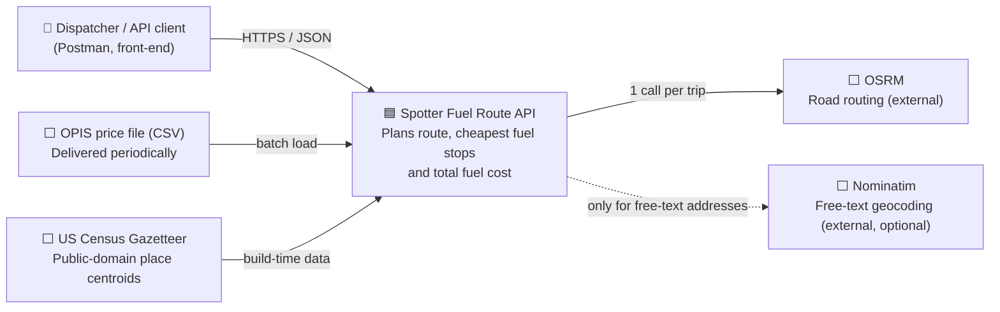
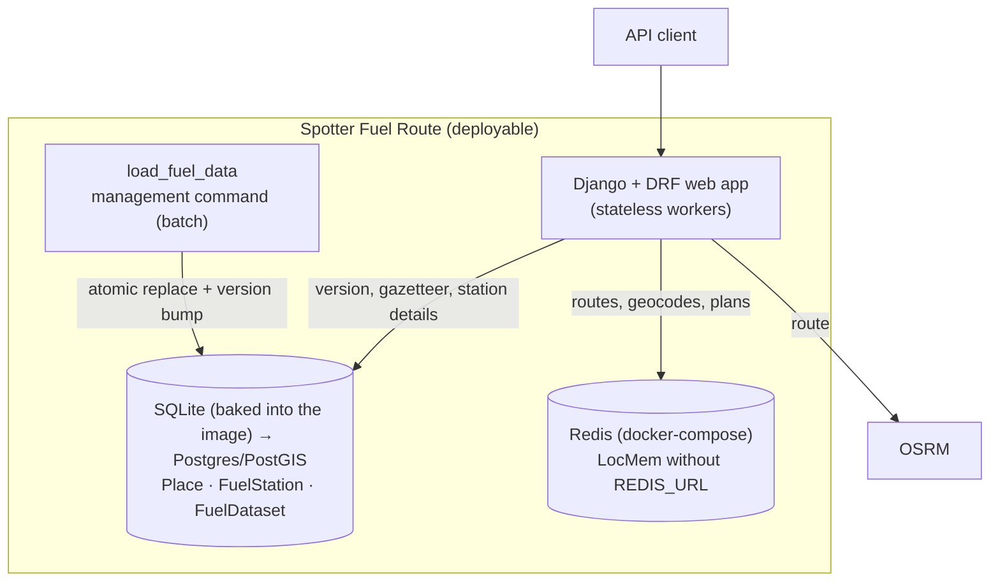
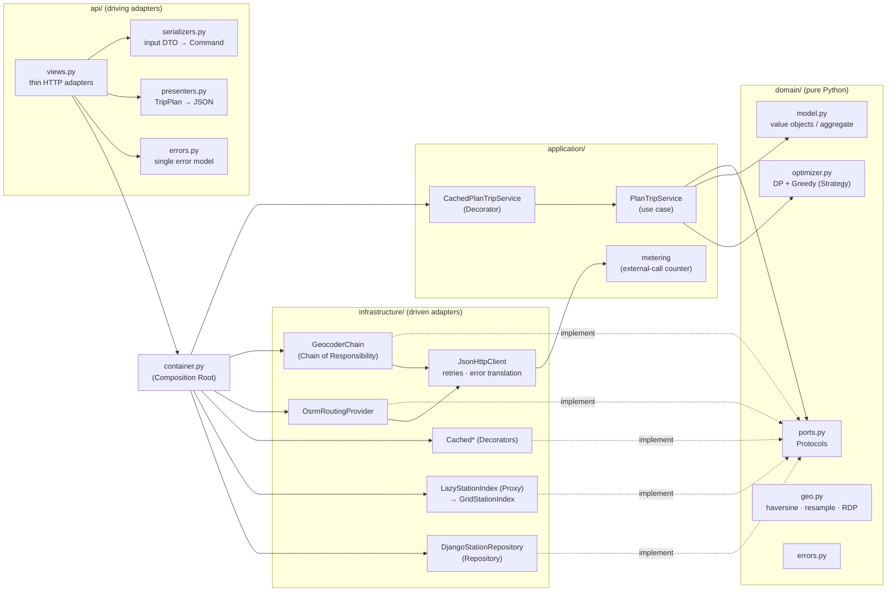
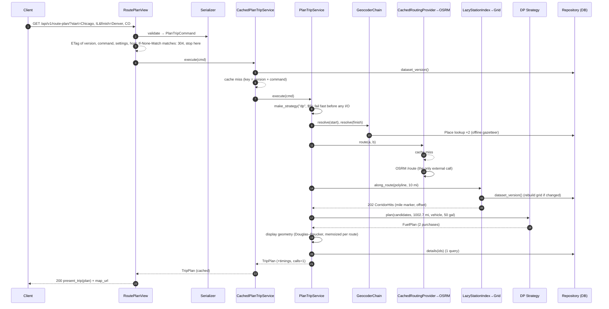
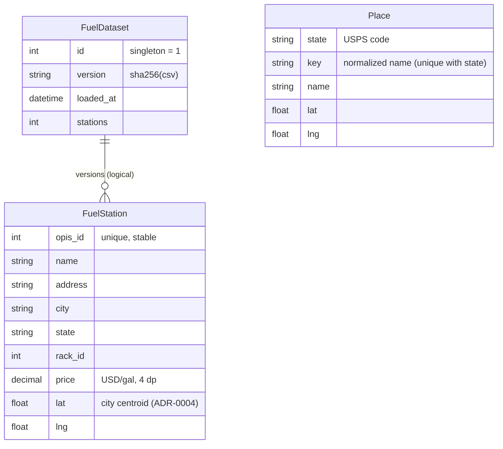

# Architecture: Spotter Fuel Route API

This document is the map. The **why** behind each decision lives in the [ADRs](adr/0001-record-architecture-decisions.md).

## 1. Quality goals

| # | Quality attribute | Target | How it is met | Evidence |
|---|---|---|---|---|
| Q1 | **Performance** | < 100 ms local compute; total dominated by a single routing call | Offline geocoding, in-memory grid index, O(n·U) DP, plan and route caches, display geometry precomputed once per route | `meta.timings_ms`: corridor 20–60 ms, optimize 10–22 ms; cache hit + present 0.31 ms. [Load test](load-test-report.md), per 8-worker node: ~900 RPS at p95 160 ms mixed; 2,087 RPS warm; 6,289 RPS for 304 revalidations |
| Q2 | **Frugal external usage** | 1 routing call per trip (≤ 3 worst case) | Gazetteer resolver chain; route cache | `meta.external_api_calls`; API tests assert 1, then 0 |
| Q3 | **Correctness** | Never run dry; optimal for the stated objective | Exact DP; greedy oracle; feasibility replay | 47 optimizer tests incl. 25 random routes |
| Q4 | **Modifiability** | Swap router, index or storage without touching the core | Hexagonal ports + composition root | `test_architecture.py`; use case runs on fakes |
| Q5 | **Data freshness** | No stale prices after a reload, across processes | Dataset version namespacing + version-aware index proxy | `test_reloading_prices_invalidates_cached_plans` |
| Q6 | **Operability** | Clear errors and observability | One error model; per-request timings and call counts | 400/422/502 tests; `meta` |
| Q7 | **Scalability and resilience** | Correct under spikes; no stampede on upstream | Stateless workers, single-flight caches, corridor memo, HTTP conditional GET, edge load shedding (ADR-0012, ADR-0013) | 0 wrong answers in ~1.7M validated requests; 2,000-user spike at 953 RPS with 0 errors |

## 2. C4 level 1: system context

## 3. C4 level 2: containers

## 4. C4 level 3: components and the dependency rule

Arrows point in the direction of dependencies. **Nothing points outward from `domain/`, and `application/` depends only on `domain/`.** `tests/test_architecture.py` enforces this.

## 5. Runtime view: one cold request

A repeated request stops at step 5 with a cache hit, about 2 ms and 0 external calls.

## 6. Design patterns catalogue

| Pattern (GoF / PoEAA / DDD) | Where | Problem it solves here | Rejected alternative |
|---|---|---|---|
| **Ports and adapters** (Hexagonal) | `domain/ports.py`, `infrastructure/*` | Core independent of OSRM, Django ORM, cache backend | Views calling `requests`/ORM directly |
| **Application service / use case** | `application/plan_trip.py` | One orchestrator; framework-free; testable with fakes | Logic in views |
| **Command** | `PlanTripCommand` | Immutable input; normalized → plan-cache key | Passing `request.query_params` around |
| **Strategy** + **registry/factory** | `domain/optimizer.py` (`DynamicProgrammingStrategy`, `GreedyStrategy`, `STRATEGIES`, `make_strategy`) | Interchangeable objectives; `?strategy=` at runtime | `if algo == ...` branches in the use case |
| **Chain of Responsibility** | `infrastructure/geocoding.py::GeocoderChain` | Cheapest resolver first; network last; add resolvers without edits | Monolithic `resolve()` with nested ifs |
| **Decorator** | `CachedRoutingProvider`, `CachedGeocoder`, `CachedPlanTripService` | Caching as a separate, composable concern with the same interface | Cache logic inside adapters / views |
| **Single-flight** | `application/singleflight.py` (in `CachedRoutingProvider`, `CachedPlanTripService`) | Concurrent misses make one upstream call or computation, so there is no cache stampede | Distributed Redis lock (ADR-0012 upgrade path) |
| **Memoization (bounded LRU)** | `_DisplayGeometry` in `plan_trip.py` | Simplify each route once, not per plan or per response | Simplifying in the presenter (37 ms per response) |
| **Conditional GET (ETag/304)** | `api/http_cache.py` | Revalidations skip all planning work; CDN-friendly | `ConditionalGetMiddleware` (computes after the work) |
| **Virtual Proxy** | `LazyStationIndex` | Defer the expensive index build; rebuild transparently on a new dataset version | Build at import (slow commands); restart on reload |
| **Repository** | `DjangoStationRepository` | Use case sees domain objects, not ORM models | QuerySets leaking into the core |
| **Value Object** / **Aggregate** | `domain/model.py` (frozen, slotted dataclasses; `TripPlan`) | Immutability ⇒ safe caching & concurrency; one consistent result object | Mutable dicts |
| **DTO** (input / output) + **Presenter** | `api/serializers.py`, `api/presenters.py` | Wire format evolves independently of the domain | Serializing domain objects directly |
| **Composition Root** (manual DI) | `container.py` | Single wiring point; tests reset it | Service locator / DI framework |
| **Exception translation** (error boundary) | `api/errors.py` | Domain errors → one HTTP envelope via DRF handler | try/except ladders per view |
| **Architecture fitness function** | `tests/test_architecture.py` | Architecture rules enforced in CI | Wiki-only rules |

## 7. Data model

## 8. Risks and technical debt register

| Item | Impact | Mitigation now | Planned fix |
|---|---|---|---|
| OSRM demo server has no SLA | Latency spikes and outages show up as 502s | Retries, 502 mapping, route cache | Self-host OSRM / ORS HGV (ADR-0003, ADR-0011) |
| Car profile, not truck | Routes may ignore truck restrictions | Documented | ORS HGV profile adapter |
| City-centroid station coordinates | Offset up to ~5 mi | 10-mi corridor; address in response | OPIS coordinates or commercial geocoder (ADR-0004) |
| Sparse West Coast data in the CSV | LA→Seattle is infeasible (422) | Clear 422 with the gap in miles | Data issue: a fuller price feed |
| Per-process LocMem cache | Lower hit rate with N workers | Version namespacing is already multi-worker safe | Redis (settings only) |
| No hours-of-service model | Plans ignore driver breaks | Documented | Extend the DP state or use MILP (ADR-0006) |
| Head-of-line blocking at saturation | `/health` and 4xx queue behind compute (~800 ms at 500 users) | Capacity knee documented (~490 RPS per node) | Edge load shedding, probe isolation, autoscaling (ADR-0012) |
| Cross-worker stampede | Up to 1 OSRM call per worker on a cold burst | Per-process single-flight | Redis lock once Redis is in place |
| Price-reload freshness window | Up to 1 s per worker (version TTL); up to 300 s at intermediaries (`max-age`) | Both configurable; ETag changes with the version | Lower `max-age` or purge the CDN on reload |
